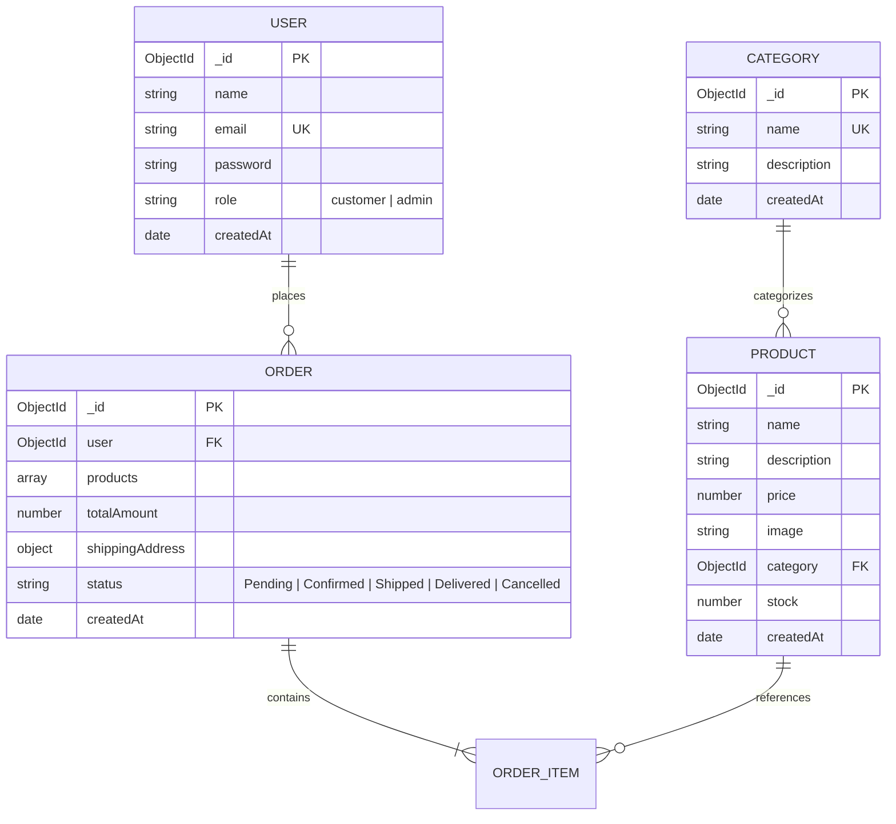

# 🛒 Mini E-Commerce Demo Project (MERN Stack)

A lightweight, clean, and modern **Full-Stack MERN (MongoDB, Express.js, React.js, Node.js)** E-Commerce demonstration platform built with role-based access control (Customer & Admin), dynamic catalog filtering, shopping cart, cash-on-delivery checkout, and real-time inventory management.

---

## 📑 Table of Contents

- [Overview](#-overview)
- [Tech Stack](#-tech-stack)
- [Project Architecture & Structure](#-project-architecture--structure)
- [Core Features](#-core-features)
  - [1. Authentication & Authorization](#1-authentication--authorization)
  - [2. Customer Storefront](#2-customer-storefront)
  - [3. Cart & Stock-Guarded Checkout](#3-cart--stock-guarded-checkout)
  - [4. Admin Management Dashboard](#4-admin-management-dashboard)
- [Data Models Overview](#-data-models-overview)
- [REST API Endpoint Summary](#-rest-api-endpoint-summary)
- [Security & Validation Principles](#-security--validation-principles)
- [Complete 11-Step Demo Workflow](#-complete-11-step-demo-workflow)
- [Local Installation & Setup Guide](#-local-installation--setup-guide)
- [Documentation Index](#-documentation-index)

---

## 🌟 Overview

The **Mini E-Commerce Demo** is crafted to provide a production-ready blueprint of an e-commerce platform while keeping the codebase concise, readable, and strictly scoped. It avoids bloated dependencies and focuses on core e-commerce mechanics:
- **Authentication**: JWT token-based auth with bcrypt-hashed credentials.
- **Role separation**: Customers can browse, cart, and order; Admins can manage categories, products, and order fulfillment states.
- **Stock integrity**: Orders strictly validate live inventory, decrement stock upon order placement, and enforce server-side price lookups.
- **Clean UI**: Tailwind CSS responsive design across mobile, tablet, and desktop with accessible interactive states.

---

## 🛠 Tech Stack

| Layer | Technology | Purpose |
| :--- | :--- | :--- |
| **Frontend UI** | [React.js](https://react.dev/) (v18+) | Component-based interactive user interface |
| **Build Tool** | [Vite](https://vitejs.dev/) | High-speed frontend tooling and local dev server |
| **Language** | JavaScript (ES Modules) | Client and server programming language |
| **Styling** | [Tailwind CSS](https://tailwindcss.com/) (v3+) | Utility-first responsive design system |
| **Icons & Feedback** | Lucide React / Heroicons + React Hot Toast | Visual clarity, loading spinners, toast alerts |
| **HTTP Client** | [Axios](https://axios-http.com/) | Promise-based HTTP client with interceptors for JWT |
| **Backend Runtime** | [Node.js](https://nodejs.org/) (v18+) | Server-side JavaScript runtime environment |
| **Web Framework** | [Express.js](https://expressjs.com/) (v4+) | RESTful API routing, middleware, error handling |
| **Database** | [MongoDB](https://www.mongodb.com/) (v6+) | NoSQL document database |
| **ODM** | [Mongoose](https://mongoosejs.com/) (v8+) | Schema validation, business models, indexing |
| **Security & Auth** | `jsonwebtoken` & `bcryptjs` | Stateless session tokens and salted password hashing |

---

## 📁 Project Architecture & Structure

The codebase is split into two cleanly separated folders:
- `/client`: Standalone React + Vite single page application (SPA).
- `/server`: Standalone Node.js + Express REST API server.

```text
mern-ecommerce-demo/
├── README.md                           # Master Project Documentation & Quickstart
├── docs/                               # Detailed Engineering Specifications
│   ├── ARCHITECTURE.md                 # System Architecture & Flow Diagrams
│   ├── DATABASE_DESIGN.md              # MongoDB Schemas & Indexing Rules
│   ├── API_SPECIFICATION.md            # REST API Contracts, Payloads & Responses
│   ├── AUTH_AND_SECURITY.md            # JWT, RBAC & Server-Side Security Rules
│   ├── FRONTEND_UI_UX.md               # Tailwind CSS Tokens & Wireframe Layouts
│   ├── DEMO_FLOW_AND_TESTING.md        # Step-by-Step Demo Verification Script
│   └── IMPLEMENTATION_ROADMAP.md       # Implementation Phases & Coding Milestones
│
├── client/                             # React Frontend (Vite)
│   ├── public/                         # Static assets (favicons, logos)
│   ├── src/
│   │   ├── api/                        # Axios instance & configured API service functions
│   │   ├── assets/                     # Demo images & static graphics
│   │   ├── components/                 # Reusable UI components
│   │   │   ├── admin/                  # Sidebar, AdminNavbar, StatsCard, StatusBadge
│   │   │   ├── common/                 # Navbar, Footer, Modal, Toast, Button, Input
│   │   │   ├── product/                # ProductCard, ProductGrid, CategoryFilter, SearchBar
│   │   │   └── cart/                   # CartItem, CartSummary
│   │   ├── context/                    # React Context providers (AuthContext, CartContext)
│   │   ├── pages/                      # Page view components
│   │   │   ├── Home.jsx                # Landing page with hero banner & featured items
│   │   │   ├── Products.jsx            # Catalog with search, filter, and pagination
│   │   │   ├── ProductDetails.jsx      # Individual product view with live stock counter
│   │   │   ├── Cart.jsx                # Cart review, quantity adjusters, subtotal
│   │   │   ├── Checkout.jsx            # Shipping address input & COD order confirmation
│   │   │   ├── Login.jsx               # Customer & Admin login form
│   │   │   ├── Register.jsx            # Customer account registration
│   │   │   ├── MyOrders.jsx            # Customer order history & fulfillment progress
│   │   │   └── admin/                  # Admin Dashboard views
│   │   │       ├── AdminDashboard.jsx  # Overview metrics & quick links
│   │   │       ├── AdminCategories.jsx # Category list, create modal, delete dialog
│   │   │       ├── AdminProducts.jsx   # Product table, create/edit modal, stock alerts
│   │   │       └── AdminOrders.jsx     # Order review table & status dropdown updater
│   │   ├── routes/                     # Protected & Role-guarded route definitions
│   │   ├── App.jsx                     # Root application wrapper with router
│   │   ├── index.css                   # Tailwind CSS directives & global styling
│   │   └── main.jsx                    # Vite entry point
│   ├── index.html                      # HTML5 template
│   ├── package.json                    # Frontend dependencies & scripts
│   ├── tailwind.config.js              # Tailwind theme configuration
│   └── vite.config.js                  # Vite configuration & dev proxy
│
└── server/                             # Node.js + Express Backend
    ├── src/
    │   ├── config/                     # Database connection & env validation
    │   │   └── db.js                   # Mongoose connection handler
    │   ├── controllers/                # Request handlers & business logic
    │   │   ├── authController.js       # Register, login, token refresh
    │   │   ├── categoryController.js   # Category CRUD operations
    │   │   ├── productController.js    # Product CRUD & query filtering
    │   │   └── orderController.js      # Order creation, customer history, status updates
    │   ├── middleware/                 # Express middleware
    │   │   ├── authMiddleware.js       # JWT token verification (protect)
    │   │   ├── adminMiddleware.js      # Admin role gatekeeper (adminOnly)
    │   │   ├── errorMiddleware.js      # Centralized error handler & 404 catcher
    │   │   └── validateMiddleware.js   # Input validation helpers
    │   ├── models/                     # Mongoose Schema definitions
    │   │   ├── User.js                 # User collection schema
    │   │   ├── Category.js             # Category collection schema
    │   │   ├── Product.js              # Product collection schema
    │   │   └── Order.js                # Order collection schema
    │   ├── routes/                     # API Route declarations
    │   │   ├── authRoutes.js           # /api/auth
    │   │   ├── categoryRoutes.js       # /api/categories
    │   │   ├── productRoutes.js        # /api/products
    │   │   └── orderRoutes.js          # /api/orders & /api/admin/orders
    │   ├── seeder/                     # Database seed scripts
    │   │   └── seed.js                 # Populates sample admin, categories, & products
    │   └── server.js                   # Express application initialization & listener
    ├── .env.example                    # Template for environment variables
    ├── package.json                    # Server dependencies & scripts
    └── .gitignore                      # Server ignore rules
```

---

## ⚡ Core Features

### 1. Authentication & Authorization
- **Customer Registration**: Requires Full Name, Email, Password, and Confirm Password (validates match & min 6 characters).
- **Customer Login**: Authenticates credentials against bcrypt hash and issues signed JWT bearer token.
- **Admin Login**: Uses identical unified endpoint or admin-flagged account to grant administrative token.
- **Middleware Protection**:
  - `protect`: Extracts Bearer token, validates signature, attaches user document to `req.user`.
  - `adminOnly`: Rejects requests with HTTP 403 Forbidden if `req.user.role !== 'admin'`.

### 2. Customer Storefront
- **Responsive Navigation**: Brand logo, search input, catalog link, cart badge with item counter, user dropdown / auth buttons.
- **Product Catalog**:
  - Real-time text search by product name/description.
  - Category pill filter: `All | Electronics | Fashion | Shoes | ...`
  - Responsive card grid displaying image, name, price, stock badge, and category tag.
- **Product Details View**: Large image display, stock availability indicator, rich description, and "Add to Cart" with quantity controls.

### 3. Cart & Stock-Guarded Checkout
- **Cart Management**:
  - Add to cart with local storage persistence.
  - Increment/decrement quantity with strict boundary checks preventing exceeding available stock.
  - Subtotal and total calculation.
- **Checkout Process**:
  - Shipping fields: Recipient Name, Phone Number, Street Address, City, Pincode.
  - Payment Method: **Cash on Delivery (COD)** exclusively.
  - Order submission executes atomic stock verification on the backend:
    1. Re-fetches current product price from MongoDB (prevents client-side price tampering).
    2. Verifies each product has sufficient stock.
    3. Creates the Order document in MongoDB.
    4. Decrements each product's stock count.
    5. Clears the client-side cart.
- **Order Tracking**: Customers can inspect order timeline and current status under `/my-orders`.

### 4. Admin Management Dashboard
- **Category Control**:
  - View all categories in a clean table with product counts.
  - Add category with name and description.
  - Edit existing category details.
  - Delete category with confirmation dialog.
- **Product Control**:
  - Tabular view of all catalog products with image thumbnail, category, price, and current stock.
  - Add new product with image URL, category assignment, price, and initial stock.
  - Edit product specifications and restock inventory.
  - Delete product with confirmation modal.
- **Order Management**:
  - Inspect all customer orders sorted by creation date.
  - View ordered items, quantities, shipping details, and total amount.
  - Update status lifecycle via dropdown:
    `Pending` ➔ `Confirmed` ➔ `Shipped` ➔ `Delivered` (or `Cancelled`).

---

## 🗄 Data Models Overview

Only four essential MongoDB collections are maintained:



*For complete schema validation code and indexing rules, refer to [docs/DATABASE_DESIGN.md](file:///C:/Users/Admin/.gemini/antigravity-ide/scratch/mern-ecommerce-demo/docs/DATABASE_DESIGN.md).*

---

## 📡 REST API Endpoint Summary

| Method | Endpoint | Access | Purpose |
| :--- | :--- | :--- | :--- |
| `POST` | `/api/auth/register` | Public | Register customer account |
| `POST` | `/api/auth/login` | Public | Authenticate user & return JWT token |
| `GET` | `/api/categories` | Public | Retrieve all categories |
| `POST` | `/api/categories` | Admin | Create a new category |
| `PUT` | `/api/categories/:id` | Admin | Update existing category |
| `DELETE` | `/api/categories/:id` | Admin | Delete category |
| `GET` | `/api/products` | Public | List products (supports `?category=...&search=...`) |
| `GET` | `/api/products/:id` | Public | Fetch single product by ID |
| `POST` | `/api/products` | Admin | Create a new product |
| `PUT` | `/api/products/:id` | Admin | Update product details / stock |
| `DELETE` | `/api/products/:id` | Admin | Remove product from catalog |
| `POST` | `/api/orders` | Customer | Place order (stock decrement & price verify) |
| `GET` | `/api/orders/my-orders` | Customer | Fetch current logged-in customer's orders |
| `GET` | `/api/admin/orders` | Admin | Fetch all orders across all customers |
| `PATCH` | `/api/admin/orders/:id/status` | Admin | Update order status (`Pending` -> `Delivered`) |

*For complete request/response payloads, refer to [docs/API_SPECIFICATION.md](file:///C:/Users/Admin/.gemini/antigravity-ide/scratch/mern-ecommerce-demo/docs/API_SPECIFICATION.md).*

---

## 🛡 Security & Validation Principles

1. **Zero-Trust Pricing**: The client cart submits only `productId` and `quantity`. The backend fetches the authoritative `price` directly from MongoDB to compute `totalAmount`.
2. **Atomic Stock Decrement**: Before saving an order, the backend verifies `stock >= requestedQuantity`. If valid, stock is decremented immediately.
3. **Password Security**: Passwords are never stored in plaintext; salted with 10 rounds of `bcrypt`.
4. **Token Security**: JWT tokens are signed with a server secret and validated via Express middleware.
5. **Strict Input Sanitization**: Backend validates email syntax, string lengths, positive numerical values, and non-negative integers for stock.

---

## 🔄 Complete 11-Step Demo Workflow

```text
1. Admin Login (/login)
   ↓
2. Admin opens Dashboard & adds Category "Electronics"
   ↓
3. Admin adds Product "Wireless Headphones" ($99.99, Stock: 15)
   ↓
4. Product immediately appears on Public Website (/products)
   ↓
5. Customer registers new account or logs in
   ↓
6. Customer browses catalog and filters by "Electronics"
   ↓
7. Customer selects item, chooses quantity, and clicks "Add to Cart"
   ↓
8. Customer opens Cart, reviews total, and proceeds to Checkout
   ↓
9. Customer enters shipping details and clicks "Place Order" (COD)
   ↓
10. Backend validates stock, stores Order, decrements stock to 14, and confirms
    ↓
11. Admin views Order in Admin Dashboard and updates status: Pending → Confirmed → Shipped
```

*For step-by-step test credentials and edge cases, see [docs/DEMO_FLOW_AND_TESTING.md](file:///C:/Users/Admin/.gemini/antigravity-ide/scratch/mern-ecommerce-demo/docs/DEMO_FLOW_AND_TESTING.md).*

---

## 🚀 Local Installation & Setup Guide

### Prerequisites
- Node.js (v18.0.0 or higher)
- npm (v9.0.0 or higher)
- MongoDB instance (local `mongod` or MongoDB Atlas URI)

### 1. Environment Configuration

#### Server Environment (`server/.env`)
```ini
PORT=5000
NODE_ENV=development
MONGO_URI=mongodb://localhost:27017/mern_mini_ecommerce
JWT_SECRET=your_super_secret_jwt_key_change_in_production
JWT_EXPIRE=7d
CLIENT_URL=http://localhost:5173
```

#### Client Environment (`client/.env`)
```ini
VITE_API_BASE_URL=http://localhost:5000/api
```

### 2. Backend Setup
```bash
cd server
npm install
# Seed initial admin user and sample catalog (optional)
npm run seed
# Start backend in development mode
npm run dev
```
*Server starts at `http://localhost:5000`.*

### 3. Frontend Setup
```bash
cd client
npm install
# Start Vite development server
npm run dev
```
*Frontend opens at `http://localhost:5173`.*

---

## 📚 Documentation Index

All architectural blueprints, database schemas, and implementation guides are available in the [`docs/`](file:///C:/Users/Admin/.gemini/antigravity-ide/scratch/mern-ecommerce-demo/docs) directory:

1. 🏛 **[System Architecture](file:///C:/Users/Admin/.gemini/antigravity-ide/scratch/mern-ecommerce-demo/docs/ARCHITECTURE.md)**: System topology, client-server data flows, and state management.
2. 🗄 **[Database Design](file:///C:/Users/Admin/.gemini/antigravity-ide/scratch/mern-ecommerce-demo/docs/DATABASE_DESIGN.md)**: Mongoose schemas, data validation, indices, and sample documents.
3. 📡 **[API Specification](file:///C:/Users/Admin/.gemini/antigravity-ide/scratch/mern-ecommerce-demo/docs/API_SPECIFICATION.md)**: Complete REST endpoint documentation with request/response samples.
4. 🔐 **[Authentication & Security](file:///C:/Users/Admin/.gemini/antigravity-ide/scratch/mern-ecommerce-demo/docs/AUTH_AND_SECURITY.md)**: JWT architecture, RBAC, and server-side validation mechanics.
5. 🎨 **[Frontend UI/UX Specification](file:///C:/Users/Admin/.gemini/antigravity-ide/scratch/mern-ecommerce-demo/docs/FRONTEND_UI_UX.md)**: Tailwind design system, component hierarchy, and wireframes.
6. 🧪 **[Demo Flow & Verification Script](file:///C:/Users/Admin/.gemini/antigravity-ide/scratch/mern-ecommerce-demo/docs/DEMO_FLOW_AND_TESTING.md)**: Step-by-step test guide with test credentials and edge cases.
7. 🗺 **[Implementation Roadmap](file:///C:/Users/Admin/.gemini/antigravity-ide/scratch/mern-ecommerce-demo/docs/IMPLEMENTATION_ROADMAP.md)**: Phased execution plan for building the MERN codebase.
