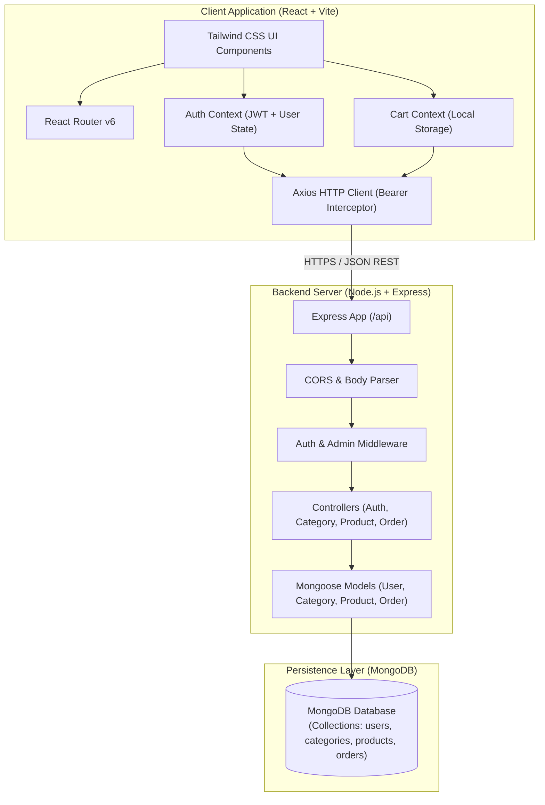
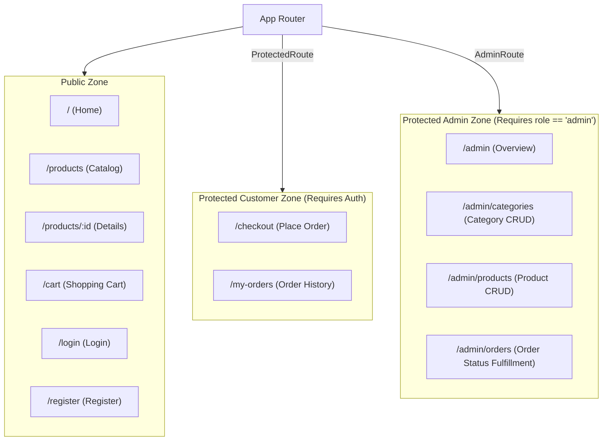
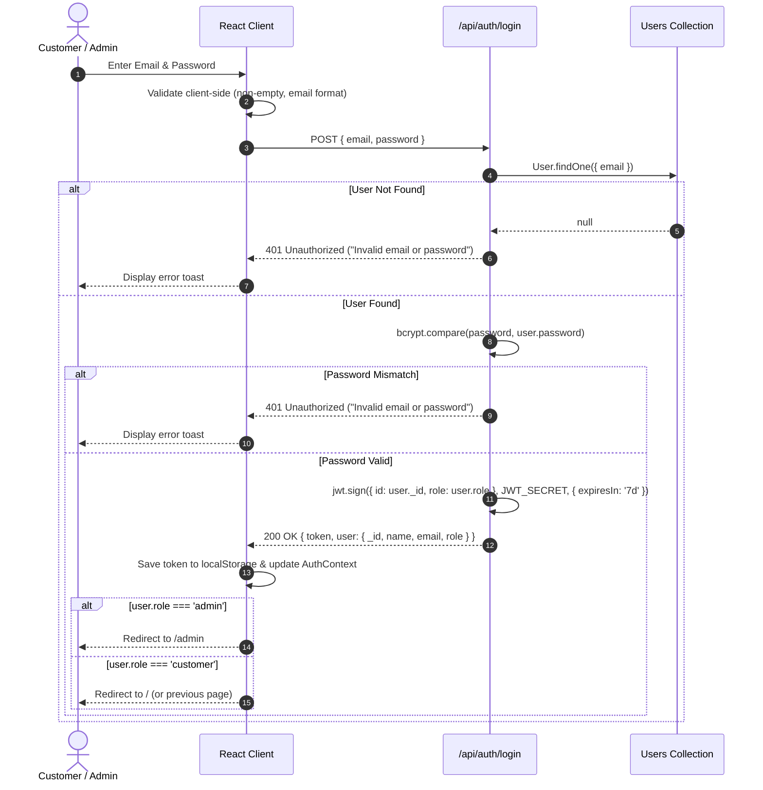
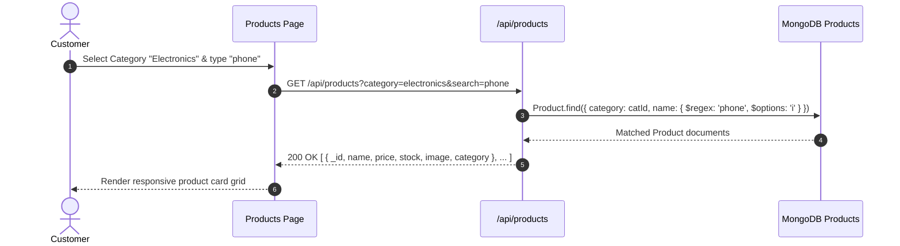
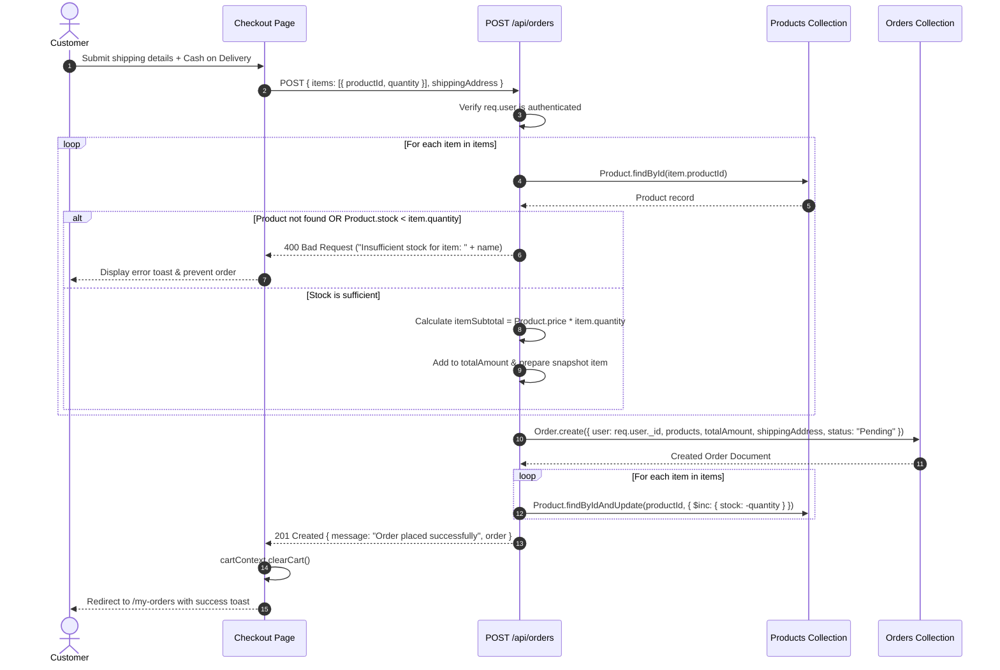
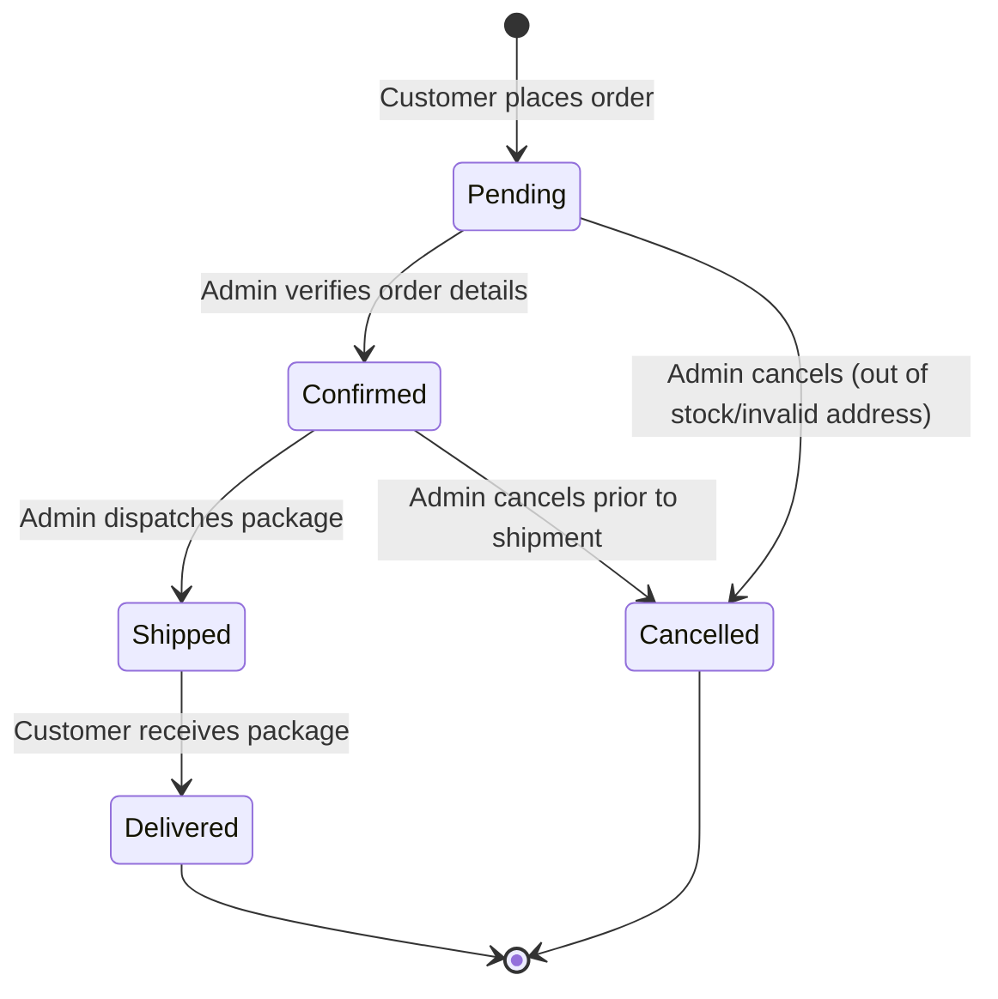

# 🏛 System Architecture & Design Blueprint

This document specifies the technical architecture, component relationships, data flow diagrams, and design patterns for the **Mini E-Commerce Demo Project (MERN Stack)**.

---

## 📑 Table of Contents

- [1. High-Level Architecture](#1-high-level-architecture)
- [2. System Topology](#2-system-topology)
- [3. Frontend Architecture (`/client`)](#3-frontend-architecture-client)
  - [3.1 Technology Stack & Build Tools](#31-technology-stack--build-tools)
  - [3.2 State Management Strategy](#32-state-management-strategy)
  - [3.3 Routing & Route Guards](#33-routing--route-guards)
- [4. Backend Architecture (`/server`)](#4-backend-architecture-server)
  - [4.1 Layered Architecture Pattern](#41-layered-architecture-pattern)
  - [4.2 Middleware Pipeline](#42-middleware-pipeline)
  - [4.3 Database Integration](#43-database-integration)
- [5. System Sequence Diagrams](#5-system-sequence-diagrams)
  - [5.1 User Authentication Flow](#51-user-authentication-flow)
  - [5.2 Product Browsing & Filtering Flow](#52-product-browsing--filtering-flow)
  - [5.3 Order Placement & Atomic Stock Decrement Flow](#53-order-placement--atomic-stock-decrement-flow)
  - [5.4 Admin Order Fulfillment Lifecycle](#54-admin-order-fulfillment-lifecycle)
- [6. Directory Layout & Module Responsibilities](#6-directory-layout--module-responsibilities)

---

## 1. High-Level Architecture

The system operates on a decoupled **Client-Server Single Page Application (SPA)** model communicating over a stateless JSON REST API.



---

## 2. System Topology

| Component | Host / Port | Responsibilities |
| :--- | :--- | :--- |
| **Frontend Client** | `http://localhost:5173` | Renders HTML/CSS DOM, handles user interactions, manages client-side routing, persists cart in localStorage, stores JWT session. |
| **Backend API** | `http://localhost:5000` | Exposes REST endpoints, validates payloads, enforces role-based authorization, executes business logic, handles database queries. |
| **Database** | `mongodb://localhost:27017` | Persists user credentials, product catalog, categories, and order transaction documents with ACID document guarantees. |

---

## 3. Frontend Architecture (`/client`)

### 3.1 Technology Stack & Build Tools
- **Vite**: Provides instant hot-module replacement (HMR) and optimized ES module bundling.
- **React 18**: Uses functional components and modern React hooks (`useState`, `useEffect`, `useContext`, `useMemo`, `useCallback`).
- **Tailwind CSS 3**: Utility-first CSS framework configured with responsive breakpoints (`sm`, `md`, `lg`, `xl`) and standard design tokens.
- **Axios Instance**: Configured with a central baseURL (`VITE_API_BASE_URL`) and an automated request interceptor that injects `Authorization: Bearer <token>`.

### 3.2 State Management Strategy
To adhere to the requirement of keeping this a lean mini-project, external complex state libraries (Redux, Zustand) are avoided. Instead, native **React Context API** is utilized:

1. **`AuthContext`**:
   - Stores current user info `{ _id, name, email, role }` and the raw JWT token.
   - Initialized by checking `localStorage.getItem('token')`.
   - Exposes methods: `login(email, password)`, `register(formData)`, and `logout()`.
   - Synchronizes token persistence in `localStorage`.

2. **`CartContext`**:
   - Stores an array of cart items: `[{ product, quantity }]`.
   - Hydrated from `localStorage.getItem('cart')` on initial load.
   - Enforces stock boundary condition: prevents `quantity > product.stock`.
   - Exposes methods: `addToCart(product, qty)`, `updateQuantity(productId, qty)`, `removeFromCart(productId)`, `clearCart()`, and derived state `cartTotal`, `cartCount`.

### 3.3 Routing & Route Guards
React Router v6 structures the application into three access zones:



---

## 4. Backend Architecture (`/server`)

### 4.1 Layered Architecture Pattern
The backend enforces a clean separation of concerns using the classic **Controller-Service-Model** pattern:

1. **Route Layer (`/routes`)**: Defines endpoint URLs, HTTP verbs, and mounts appropriate middlewares.
2. **Middleware Layer (`/middleware`)**: Handles cross-cutting concerns (token verification, role validation, input sanitization, global error catching).
3. **Controller Layer (`/controllers`)**: Extracts parameters from `req.body`, `req.query`, and `req.params`, performs input checks, coordinates model operations, and returns standardized JSON responses.
4. **Data Model Layer (`/models`)**: Defines Mongoose schemas, validators, pre-save hooks (bcrypt hashing), and indexes.

### 4.2 Middleware Pipeline

```mermaid
sequenceDiagram
    autonumber
    actor Client
    participant Express as Express Routing
    participant AuthMW as Auth Middleware (protect)
    participant AdminMW as Admin Middleware (adminOnly)
    participant Controller as Route Controller
    participant DB as MongoDB

    Client->>Express: HTTP Request + Bearer Token
    Express->>AuthMW: Inspect Authorization Header
    alt Token Missing or Invalid
        AuthMW-->>Client: 401 Unauthorized { message: "Not authorized, token failed" }
    else Valid Token
        AuthMW->>DB: User.findById(decoded.id).select('-password')
        DB-->>AuthMW: User document
        AuthMW->>Express: req.user = user; next()
        alt Admin Route Requested
            Express->>AdminMW: Check req.user.role === 'admin'
            alt Not Admin
                AdminMW-->>Client: 403 Forbidden { message: "Admin access required" }
            else Is Admin
                AdminMW->>Controller: next()
            end
        else Standard Protected Route
            Express->>Controller: Invoke controller handler
        end
        Controller->>DB: Execute business logic
        DB-->>Controller: Result
        Controller-->>Client: 200/201 JSON Response
    end
```

---

## 5. System Sequence Diagrams

### 5.1 User Authentication Flow



### 5.2 Product Browsing & Filtering Flow



### 5.3 Order Placement & Atomic Stock Decrement Flow

> [!IMPORTANT]
> **Zero-Trust Pricing Rule**: The frontend submits only product IDs and requested quantities. The server performs an authoritative price lookup directly from MongoDB to compute the true total.



### 5.4 Admin Order Fulfillment Lifecycle



---

## 6. Directory Layout & Module Responsibilities

### Client Modules
- `src/api/client.js`: Configured Axios instance with request and response interceptors.
- `src/context/AuthContext.jsx`: User state, login, register, logout, token persistence.
- `src/context/CartContext.jsx`: Cart items, quantity controls, stock bounds checking.
- `src/components/common/Navbar.jsx`: Storefront header with category shortcuts, search trigger, cart counter, user menu.
- `src/components/admin/AdminSidebar.jsx`: Collapsible navigation sidebar for Categories, Products, Orders, and Storefront switch.
- `src/pages/admin/AdminOrders.jsx`: Table view of customer orders with live status mutation selector.

### Server Modules
- `src/config/db.js`: Initializes Mongoose connection with error handling and reconnection logic.
- `src/middleware/authMiddleware.js`: Extracts Bearer token, verifies JWT, attaches `req.user`.
- `src/middleware/adminMiddleware.js`: Checks `req.user && req.user.role === 'admin'`.
- `src/controllers/orderController.js`: Encapsulates zero-trust pricing, stock validation, decrement, and status transitions.
- `src/seeder/seed.js`: Standalone script to populate a default admin (`admin@example.com` / `admin123`), sample categories, and demo products.
