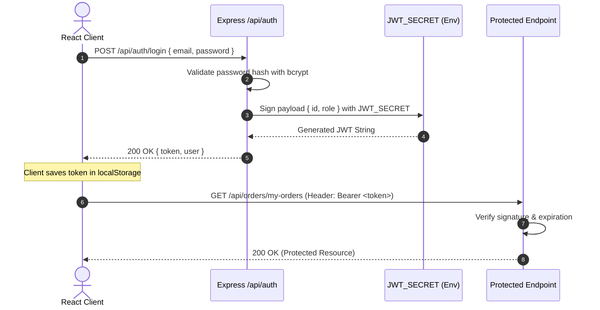

# 🔐 Authentication, Authorization & Security Architecture

This document specifies the security controls, authentication mechanisms, token lifecycles, role-based access rules, and validation safeguards implemented across the **Mini E-Commerce Demo Project**.

---

## 📑 Table of Contents

- [1. Threat Model & Security Principles](#1-threat-model--security-principles)
- [2. JSON Web Token (JWT) Lifecycle](#2-json-web-token-jwt-lifecycle)
  - [2.1 Token Generation & Claims](#21-token-generation--claims)
  - [2.2 Client-Side Storage & Request Header Injection](#22-client-side-storage--request-header-injection)
  - [2.3 Token Verification Middleware (`protect`)](#23-token-verification-middleware-protect)
- [3. Role-Based Access Control (RBAC)](#3-role-based-access-control-rbac)
  - [3.1 Role Hierarchy](#31-role-hierarchy)
  - [3.2 Admin Route Guard Middleware (`adminOnly`)](#32-admin-route-guard-middleware-adminonly)
- [4. Password Hashing & Handling](#4-password-hashing--handling)
- [5. Zero-Trust E-Commerce Pricing & Inventory Protection](#5-zero-trust-e-commerce-pricing--inventory-protection)
  - [5.1 Server-Side Price Lookup Guarantee](#51-server-side-price-lookup-guarantee)
  - [5.2 Atomic Stock Verification & Decrement](#52-atomic-stock-verification--decrement)
- [6. Input Validation & Sanitization](#6-input-validation--sanitization)
- [7. CORS & Environment Variable Configuration](#7-cors--environment-variable-configuration)

---

## 1. Threat Model & Security Principles

Online retail systems are vulnerable to client-side manipulation, price tampering, inventory depletion attacks, and unauthorized privilege escalation. The architecture enforces four non-negotiable security principles:

1. **Zero-Trust Client Pricing**: The frontend is treated as untrusted. Client-submitted prices are ignored; prices are fetched dynamically from MongoDB.
2. **Defensive Inventory Management**: Orders cannot cause stock to drop below zero.
3. **Least Privilege (RBAC)**: Administrative routes require both a valid token and an explicit `role === 'admin'` claim.
4. **Defense in Depth**: Validation occurs on the client for user experience and on the server for security enforcement.

---

## 2. JSON Web Token (JWT) Lifecycle



### 2.1 Token Generation & Claims

Tokens are generated server-side using `jsonwebtoken`:

```javascript
// server/src/utils/generateToken.js
import jwt from 'jsonwebtoken';

export const generateToken = (userId, role) => {
  return jwt.sign(
    {
      id: userId,
      role: role
    },
    process.env.JWT_SECRET,
    {
      expiresIn: process.env.JWT_EXPIRE || '7d'
    }
  );
};
```

- **Claims**:
  - `id`: MongoDB `ObjectId` string of the user.
  - `role`: `'customer'` or `'admin'`.
  - `iat`: Timestamp issued at.
  - `exp`: Expiration (defaults to 7 days).

### 2.2 Client-Side Storage & Request Header Injection

The React frontend stores the token in `localStorage` under the key `'token'`. An Axios interceptor automatically attaches the header to every outgoing HTTP request:

```javascript
// client/src/api/client.js
import axios from 'axios';

const api = axios.create({
  baseURL: import.meta.env.VITE_API_BASE_URL || 'http://localhost:5000/api'
});

api.interceptors.request.use((config) => {
  const token = localStorage.getItem('token');
  if (token) {
    config.headers.Authorization = `Bearer ${token}`;
  }
  return config;
});

export default api;
```

### 2.3 Token Verification Middleware (`protect`)

The `protect` middleware extracts the Bearer token, validates its signature, and resolves the active user document from the database (excluding password hash):

```javascript
// server/src/middleware/authMiddleware.js
import jwt from 'jsonwebtoken';
import User from '../models/User.js';

export const protect = async (req, res, next) => {
  let token;

  if (
    req.headers.authorization &&
    req.headers.authorization.startsWith('Bearer')
  ) {
    try {
      token = req.headers.authorization.split(' ')[1];
      const decoded = jwt.verify(token, process.env.JWT_SECRET);
      
      req.user = await User.findById(decoded.id).select('-password');
      if (!req.user) {
        return res.status(401).json({ success: false, message: 'User not found with this token' });
      }

      next();
    } catch (error) {
      return res.status(401).json({ success: false, message: 'Not authorized, token verification failed' });
    }
  } else {
    return res.status(401).json({ success: false, message: 'Not authorized, no token provided' });
  }
};
```

---

## 3. Role-Based Access Control (RBAC)

### 3.1 Role Hierarchy

```text
[Public / Guest]
       │
       ▼ (Register / Login)
[Customer]
   ├── Browse catalog, search, filter
   ├── Add to cart & view totals
   ├── Checkout (COD)
   └── View personal order history (/my-orders)
       │
       ▼ (Assigned role === 'admin')
[Admin]
   ├── All Customer privileges
   ├── Create, update, delete Categories
   ├── Create, update, delete Products
   ├── View all customer orders
   └── Update order fulfillment status (Pending -> Delivered)
```

### 3.2 Admin Route Guard Middleware (`adminOnly`)

Admin endpoints apply both `protect` and `adminOnly` in sequential chain:

```javascript
// server/src/middleware/adminMiddleware.js
export const adminOnly = (req, res, next) => {
  if (req.user && req.user.role === 'admin') {
    next();
  } else {
    res.status(403).json({
      success: false,
      message: 'Access forbidden: Administrator privileges required'
    });
  }
};
```

---

## 4. Password Hashing & Handling

1. **Algorithm**: `bcryptjs` with a work factor of 10 salt rounds.
2. **Pre-Save Automatic Hashing**:
   - Mongoose `userSchema.pre('save')` evaluates `this.isModified('password')`. If modified or new, bcrypt generates salt and hashes the plain text.
3. **Query Exclusion**:
   - `password` field has `select: false` configured on the schema.
   - Prevents accidental exposure of password hashes in user lookup queries, order receipts, or logging.

---

## 5. Zero-Trust E-Commerce Pricing & Inventory Protection

### 5.1 Server-Side Price Lookup Guarantee

> [!WARNING]
> **Common Vulnerability**: Malicious clients modifying the JavaScript DOM or sending intercepted HTTP payloads with `price: 0.01` instead of `price: 199.99`.

**Enforced Protection**:
The client is strictly restricted to sending:
```json
{
  "items": [
    { "productId": "660c1a8f9b1d8e001f34a301", "quantity": 2 }
  ]
}
```
The server iterates through each submitted `productId`, retrieves the trusted price from MongoDB, and calculates the true `totalAmount`:

```javascript
let calculatedTotal = 0;
const snapshotProducts = [];

for (const item of req.body.items) {
  const product = await Product.findById(item.productId);
  if (!product) {
    return res.status(404).json({ success: false, message: `Product not found: ${item.productId}` });
  }

  // Stock check
  if (product.stock < item.quantity) {
    return res.status(400).json({
      success: false,
      message: `Insufficient stock for ${product.name}. Available: ${product.stock}`
    });
  }

  calculatedTotal += product.price * item.quantity;
  snapshotProducts.push({
    product: product._id,
    name: product.name,
    price: product.price, // Trusted server price
    quantity: item.quantity
  });
}
```

### 5.2 Atomic Stock Verification & Decrement

To prevent race conditions where two customers purchase the last unit simultaneously:
1. Verify `product.stock >= item.quantity`.
2. Apply decrement using MongoDB's atomic operator `$inc`:
```javascript
await Product.updateOne(
  { _id: item.productId, stock: { $gte: item.quantity } },
  { $inc: { stock: -item.quantity } }
);
```

---

## 6. Input Validation & Sanitization

| Field | Client-Side Check | Server-Side Validation |
| :--- | :--- | :--- |
| **Email** | HTML5 `type="email"` + Regex match | Mongoose regex match + `.toLowerCase().trim()` + unique index |
| **Password** | Min 6 chars, match check with `confirmPassword` | `minlength: 6`, server-side comparison |
| **Product Price** | HTML5 `min="0.01"` `step="0.01"` | `min: [0.01, 'Price must be positive']`, `typeof price === 'number'` |
| **Product Stock** | HTML5 `min="0"` `step="1"` | `min: [0, 'Stock cannot be negative']`, integer validator |
| **Order Status** | Dropdown selection from fixed list | Mongoose enum: `['Pending', 'Confirmed', 'Shipped', 'Delivered', 'Cancelled']` |
| **Shipping Info** | All fields required before submit | Sub-document required fields: `name`, `phone`, `address`, `city`, `pincode` |

---

## 7. CORS & Environment Variable Configuration

### CORS Configuration
Cross-Origin Resource Sharing is locked down to the frontend origin:
```javascript
import cors from 'cors';

app.use(cors({
  origin: process.env.CLIENT_URL || 'http://localhost:5173',
  credentials: true,
  methods: ['GET', 'POST', 'PUT', 'PATCH', 'DELETE']
}));
```

### Environment Variables Matrix
| Variable | Purpose | Example Value |
| :--- | :--- | :--- |
| `PORT` | Express listening port | `5000` |
| `NODE_ENV` | Environment state | `development` / `production` |
| `MONGO_URI` | MongoDB connection string | `mongodb://localhost:27017/mern_mini_ecommerce` |
| `JWT_SECRET` | Private signing secret | `ecommerce_super_secure_demo_key_2026` |
| `JWT_EXPIRE` | Token validity duration | `7d` |
| `CLIENT_URL` | Allowed CORS frontend host | `http://localhost:5173` |
