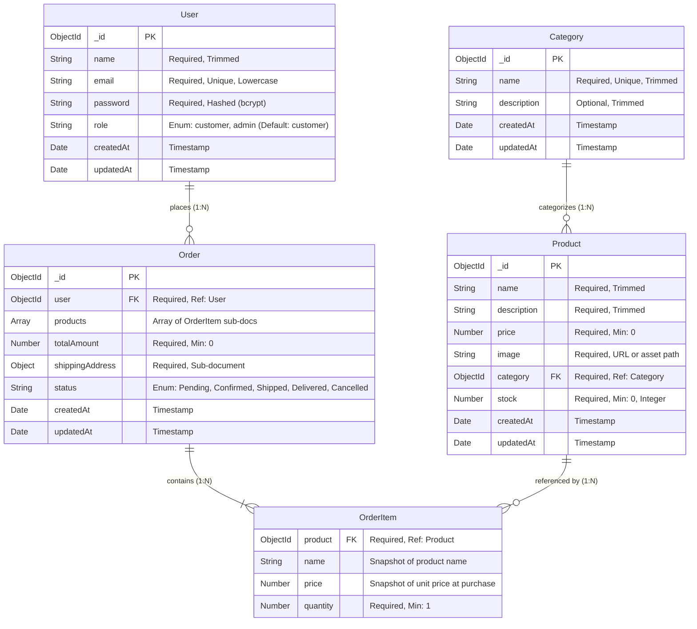

# 🗄 Database Design & Schema Specifications

This document outlines the complete database architecture, Mongoose schema definitions, field validations, indexing strategies, relationships, and seed fixtures for the **Mini E-Commerce Demo Project**.

---

## 📑 Table of Contents

- [1. Entity Relationship (ER) Model](#1-entity-relationship-er-model)
- [2. Model Definitions](#2-model-definitions)
  - [2.1 User Model](#21-user-model)
  - [2.2 Category Model](#22-category-model)
  - [2.3 Product Model](#23-product-model)
  - [2.4 Order Model](#24-order-model)
- [3. Indexing Strategy](#3-indexing-strategy)
- [4. Data Integrity & Validation Rules](#4-data-integrity--validation-rules)
- [5. Sample Documents (JSON Fixtures)](#5-sample-documents-json-fixtures)
- [6. Database Seeder Strategy](#6-database-seeder-strategy)

---

## 1. Entity Relationship (ER) Model



---

## 2. Model Definitions

### 2.1 User Model

The `User` collection stores credentials for both regular customers and administrative staff.

```javascript
// server/src/models/User.js
import mongoose from 'mongoose';
import bcrypt from 'bcryptjs';

const userSchema = new mongoose.Schema(
  {
    name: {
      type: String,
      required: [true, 'Please provide your full name'],
      trim: true,
      maxlength: [50, 'Name cannot exceed 50 characters']
    },
    email: {
      type: String,
      required: [true, 'Please provide an email address'],
      unique: true,
      lowercase: true,
      trim: true,
      match: [
        /^\w+([.-]?\w+)*@\w+([.-]?\w+)*(\.\w{2,3})+$/,
        'Please provide a valid email address'
      ]
    },
    password: {
      type: String,
      required: [true, 'Please provide a password'],
      minlength: [6, 'Password must be at least 6 characters'],
      select: false // Excluded by default in queries for security
    },
    role: {
      type: String,
      enum: {
        values: ['customer', 'admin'],
        message: '{VALUE} is not a valid user role'
      },
      default: 'customer'
    }
  },
  {
    timestamps: true
  }
);

// Pre-save hook: Hash password with bcrypt before persisting
userSchema.pre('save', async function (next) {
  if (!this.isModified('password')) return next();
  const salt = await bcrypt.genSalt(10);
  this.password = await bcrypt.hash(this.password, salt);
  next();
});

// Helper method: Compare submitted password with hashed password
userSchema.methods.matchPassword = async function (enteredPassword) {
  return await bcrypt.compare(enteredPassword, this.password);
};

export default mongoose.model('User', userSchema);
```

---

### 2.2 Category Model

The `Category` collection organizes products into logical groupings.

```javascript
// server/src/models/Category.js
import mongoose from 'mongoose';

const categorySchema = new mongoose.Schema(
  {
    name: {
      type: String,
      required: [true, 'Category name is required'],
      unique: true,
      trim: true,
      maxlength: [40, 'Category name cannot exceed 40 characters']
    },
    description: {
      type: String,
      trim: true,
      maxlength: [200, 'Description cannot exceed 200 characters'],
      default: ''
    }
  },
  {
    timestamps: true
  }
);

export default mongoose.model('Category', categorySchema);
```

---

### 2.3 Product Model

The `Product` collection represents items available for purchase in the public catalog.

```javascript
// server/src/models/Product.js
import mongoose from 'mongoose';

const productSchema = new mongoose.Schema(
  {
    name: {
      type: String,
      required: [true, 'Product name is required'],
      trim: true,
      maxlength: [100, 'Product name cannot exceed 100 characters']
    },
    description: {
      type: String,
      required: [true, 'Product description is required'],
      trim: true,
      maxlength: [1000, 'Description cannot exceed 1000 characters']
    },
    price: {
      type: Number,
      required: [true, 'Product price is required'],
      min: [0.01, 'Price must be greater than zero']
    },
    image: {
      type: String,
      required: [true, 'Product image URL is required'],
      trim: true
    },
    category: {
      type: mongoose.Schema.Types.ObjectId,
      ref: 'Category',
      required: [true, 'Product must belong to a valid category']
    },
    stock: {
      type: Number,
      required: [true, 'Product stock is required'],
      min: [0, 'Stock cannot be negative'],
      validate: {
        validator: Number.isInteger,
        message: '{VALUE} is not an integer stock value'
      },
      default: 0
    }
  },
  {
    timestamps: true
  }
);

// Compound text index for fast search by name & description
productSchema.index({ name: 'text', description: 'text' });

export default mongoose.model('Product', productSchema);
```

---

### 2.4 Order Model

The `Order` collection stores placed orders, including snapshot pricing and shipping destination.

```javascript
// server/src/models/Order.js
import mongoose from 'mongoose';

const orderItemSchema = new mongoose.Schema(
  {
    product: {
      type: mongoose.Schema.Types.ObjectId,
      ref: 'Product',
      required: true
    },
    name: {
      type: String,
      required: true
    },
    price: {
      type: Number,
      required: true,
      min: [0, 'Price must be positive']
    },
    quantity: {
      type: Number,
      required: true,
      min: [1, 'Quantity must be at least 1'],
      validate: {
        validator: Number.isInteger,
        message: '{VALUE} must be an integer'
      }
    }
  },
  { _id: false }
);

const shippingAddressSchema = new mongoose.Schema(
  {
    name: {
      type: String,
      required: [true, 'Recipient name is required'],
      trim: true
    },
    phone: {
      type: String,
      required: [true, 'Phone number is required'],
      trim: true
    },
    address: {
      type: String,
      required: [true, 'Street address is required'],
      trim: true
    },
    city: {
      type: String,
      required: [true, 'City is required'],
      trim: true
    },
    pincode: {
      type: String,
      required: [true, 'Pincode is required'],
      trim: true
    }
  },
  { _id: false }
);

const orderSchema = new mongoose.Schema(
  {
    user: {
      type: mongoose.Schema.Types.ObjectId,
      ref: 'User',
      required: true
    },
    products: {
      type: [orderItemSchema],
      required: true,
      validate: {
        validator: function (v) {
          return Array.isArray(v) && v.length > 0;
        },
        message: 'Order must contain at least one product'
      }
    },
    totalAmount: {
      type: Number,
      required: true,
      min: [0, 'Total amount cannot be negative']
    },
    shippingAddress: {
      type: shippingAddressSchema,
      required: true
    },
    paymentMethod: {
      type: String,
      enum: ['COD'],
      default: 'COD'
    },
    status: {
      type: String,
      enum: {
        values: ['Pending', 'Confirmed', 'Shipped', 'Delivered', 'Cancelled'],
        message: '{VALUE} is not a supported order status'
      },
      default: 'Pending'
    }
  },
  {
    timestamps: true
  }
);

// Indexes for high-frequency queries
orderSchema.index({ user: 1, createdAt: -1 });
orderSchema.index({ status: 1 });

export default mongoose.model('Order', orderSchema);
```

---

## 3. Indexing Strategy

| Collection | Index Fields | Type | Purpose |
| :--- | :--- | :--- | :--- |
| `users` | `{ email: 1 }` | Unique B-Tree | Guarantees uniqueness; accelerates authentication lookups |
| `categories` | `{ name: 1 }` | Unique B-Tree | Avoids duplicate category creation |
| `products` | `{ category: 1 }` | B-Tree | Fast category-based filtering |
| `products` | `{ name: 'text', description: 'text' }` | Text Index | High-speed keyword search via `$text: { $search: query }` |
| `products` | `{ price: 1 }` | B-Tree | Optional price range sorting |
| `orders` | `{ user: 1, createdAt: -1 }` | Compound B-Tree | Fast retrieval of a customer's recent orders |
| `orders` | `{ status: 1 }` | B-Tree | Fast filtering of pending/confirmed orders in admin panel |

---

## 4. Data Integrity & Validation Rules

1. **Email Lowercasing & Format**:
   - Emails are lowercased and stripped of leading/trailing whitespace prior to uniqueness verification.
2. **Product Price Authority (Zero-Trust Principle)**:
   - When an order is created, the server does **not** accept the item prices sent in the client request body.
   - For every `productId` submitted, the server retrieves the authoritative price from MongoDB and re-multiplies by the quantity.
3. **Stock Non-Negativity**:
   - Stock values are strictly integers `min: 0`.
   - Before completing an order, the server checks `product.stock >= quantity`. If any item fails, the transaction is rejected.
4. **Historical Price Snapshot**:
   - The `Order.products` array duplicates the `name` and `price` at the moment of checkout. If a product's price or name changes later, past order records remain unchanged.

---

## 5. Sample Documents (JSON Fixtures)

### User Document
```json
{
  "_id": "660c1a8f9b1d8e001f34a101",
  "name": "Jane Doe",
  "email": "jane@example.com",
  "role": "customer",
  "createdAt": "2026-10-02T10:00:00.000Z",
  "updatedAt": "2026-10-02T10:00:00.000Z"
}
```

### Category Document
```json
{
  "_id": "660c1a8f9b1d8e001f34a201",
  "name": "Electronics",
  "description": "Smartphones, headphones, and modern gadgets",
  "createdAt": "2026-10-02T10:05:00.000Z",
  "updatedAt": "2026-10-02T10:05:00.000Z"
}
```

### Product Document
```json
{
  "_id": "660c1a8f9b1d8e001f34a301",
  "name": "Noise-Cancelling Wireless Headphones",
  "description": "Premium over-ear headphones with 30-hour battery life and active noise cancellation.",
  "price": 129.99,
  "image": "https://images.unsplash.com/photo-1505740420928-5e560c06d30e?w=600",
  "category": "660c1a8f9b1d8e001f34a201",
  "stock": 25,
  "createdAt": "2026-10-02T10:10:00.000Z",
  "updatedAt": "2026-10-02T10:10:00.000Z"
}
```

### Order Document
```json
{
  "_id": "660c1a8f9b1d8e001f34a401",
  "user": "660c1a8f9b1d8e001f34a101",
  "products": [
    {
      "product": "660c1a8f9b1d8e001f34a301",
      "name": "Noise-Cancelling Wireless Headphones",
      "price": 129.99,
      "quantity": 1
    }
  ],
  "totalAmount": 129.99,
  "shippingAddress": {
    "name": "Jane Doe",
    "phone": "+1 555-0199",
    "address": "456 Market Street, Suite 100",
    "city": "San Francisco",
    "pincode": "94105"
  },
  "paymentMethod": "COD",
  "status": "Pending",
  "createdAt": "2026-10-02T11:30:00.000Z",
  "updatedAt": "2026-10-02T11:30:00.000Z"
}
```

---

## 6. Database Seeder Strategy

A seeding script (`server/src/seeder/seed.js`) provides an out-of-the-box demo state:

1. **Admin Seed**:
   - `name`: "System Admin"
   - `email`: `admin@example.com`
   - `password`: `admin123` (hashed via User pre-save hook)
   - `role`: `admin`
2. **Customer Seed**:
   - `name`: "John Customer"
   - `email`: `john@example.com`
   - `password`: `customer123`
   - `role`: `customer`
3. **Categories Seed**:
   - `Electronics`
   - `Fashion`
   - `Shoes`
   - `Accessories`
4. **Products Seed**:
   - 8 diverse products with high-resolution imagery, realistic prices, and varied stock counts (including one low-stock item to demonstrate stock limits).
