# 🗺 Implementation Roadmap & Milestone Checklist

This document details the phased development plan for transitioning from architectural specifications to a fully functional **Mini E-Commerce Demo Project (MERN Stack)**.

---

## 📑 Phased Milestone Overview

```mermaid
gantt
    title MERN Mini E-Commerce Implementation Timeline
    dateFormat  X
    axisFormat  Day %d
    
    section Foundation
    Phase 1 : Scaffolding & Config        :p1, 0, 1
    Phase 2 : Database Models & Seeder    :p2, 1, 2
    
    section Backend APIs
    Phase 3 : Auth & Security Middlewares :p3, 2, 3
    Phase 4 : Category & Product APIs     :p4, 3, 4
    Phase 5 : Order API & Stock Decrement :p5, 4, 5
    
    section Frontend Storefront
    Phase 6 : Client Setup & Tailwind     :p6, 5, 6
    Phase 7 : Context State (Auth/Cart)   :p7, 6, 7
    Phase 8 : Public Storefront Pages     :p8, 7, 8
    Phase 9 : Cart & COD Checkout Flow    :p9, 8, 9
    
    section Admin & Polish
    Phase 10: Admin Management Dashboard  :p10, 9, 10
    Phase 11: End-to-End Testing & Polish :p11, 10, 11
```

---

## Phase 1: Project Scaffolding & Configuration
- [ ] Initialize `/server` directory with `package.json` (Express, Mongoose, dotenv, cors, bcryptjs, jsonwebtoken).
- [ ] Initialize `/client` directory with Vite (`react` template) + Tailwind CSS (`tailwindcss`, `postcss`, `autoprefixer`).
- [ ] Configure `tailwind.config.js` with project colors and content paths.
- [ ] Setup `.env.example` in `/server` and `/client`.
- [ ] Add root `.gitignore` to prevent tracking of `node_modules/`, `.env`, and build outputs.

---

## Phase 2: Database Connection, Models & Seeder
- [ ] Implement `server/src/config/db.js` with Mongoose connection handling.
- [ ] Implement `server/src/models/User.js` with bcrypt pre-save hook and `matchPassword` method.
- [ ] Implement `server/src/models/Category.js` with name uniqueness.
- [ ] Implement `server/src/models/Product.js` with text search indexes and positive number validation.
- [ ] Implement `server/src/models/Order.js` with embedded snapshot items and shipping address schema.
- [ ] Write standalone seeder script `server/src/seeder/seed.js` with sample admin, categories, and products.

---

## Phase 3: JWT Authentication & Middleware
- [ ] Implement token generation utility `server/src/utils/generateToken.js`.
- [ ] Implement `authMiddleware.js` (`protect`) verifying Bearer JWT and attaching `req.user`.
- [ ] Implement `adminMiddleware.js` (`adminOnly`) verifying `req.user.role === 'admin'`.
- [ ] Build `authController.js` and mount `POST /api/auth/register` and `POST /api/auth/login`.
- [ ] Implement global error handling middleware in `errorMiddleware.js`.

---

## Phase 4: Category & Product Management APIs
- [ ] Implement `categoryController.js`:
  - `GET /api/categories` (public)
  - `POST /api/categories` (admin)
  - `PUT /api/categories/:id` (admin)
  - `DELETE /api/categories/:id` (admin with product dependency check)
- [ ] Implement `productController.js`:
  - `GET /api/products` (public with `?category=...&search=...` query logic)
  - `GET /api/products/:id` (public with populated category)
  - `POST /api/products` (admin)
  - `PUT /api/products/:id` (admin)
  - `DELETE /api/products/:id` (admin)

---

## Phase 5: Order API & Stock Decrement Mechanics
- [ ] Implement `orderController.js`:
  - `POST /api/orders`:
    - Enforce server-side authoritative price lookup.
    - Check stock availability for all cart items.
    - Atomic stock decrement via `Product.updateOne({ $inc: { stock: -qty } })`.
    - Create Order document with `status: 'Pending'` and `paymentMethod: 'COD'`.
  - `GET /api/orders/my-orders`: Retrieve logged-in customer's orders.
  - `GET /api/admin/orders`: Retrieve all customer orders (admin only).
  - `PATCH /api/admin/orders/:id/status`: Update status lifecycle (admin only).

---

## Phase 6: Frontend Setup & Shared UI Components
- [ ] Configure Axios client with baseURL and token request interceptor in `client/src/api/client.js`.
- [ ] Setup `react-router-dom` with Public, Protected, and Admin routes.
- [ ] Configure `react-hot-toast` provider in `App.jsx`.
- [ ] Build reusable UI components:
  - `Navbar.jsx`: Brand logo, search bar, category shortcuts, cart badge, auth controls.
  - `Footer.jsx`: Clean minimal footer.
  - `Modal.jsx` & `ConfirmDialog.jsx`: Accessible modal dialogs.
  - `LoadingSpinner.jsx` & `EmptyState.jsx`.

---

## Phase 7: Client State Management (Auth & Cart Context)
- [ ] Implement `AuthContext.jsx`:
  - `user`, `token`, `isAuthenticated`, `isAdmin`.
  - Methods: `login(email, password)`, `register(data)`, `logout()`.
  - Token synchronization with `localStorage`.
- [ ] Implement `CartContext.jsx`:
  - `cartItems`, `cartCount`, `cartTotal`.
  - Methods: `addToCart(product, qty)`, `updateQuantity(id, qty)`, `removeFromCart(id)`, `clearCart()`.
  - Enforce upper limit bound: `qty <= product.stock`.
  - Synchronize cart state with `localStorage`.

---

## Phase 8: Public Storefront Views
- [ ] `Home.jsx`: Hero banner, quick category links, top featured products.
- [ ] `Products.jsx`:
  - Search input with debounce.
  - Category pill filter bar (`All | Electronics | Fashion | Shoes | ...`).
  - Responsive product card grid with hover effects and stock status badges.
- [ ] `ProductDetails.jsx`:
  - High-res product image display.
  - Live stock status badge.
  - Quantity picker and Add to Cart button.
- [ ] `Login.jsx` & `Register.jsx`:
  - Clean authentication cards with validation errors and quick-fill demo credentials.

---

## Phase 9: Cart & COD Checkout Experience
- [ ] `Cart.jsx`:
  - Line item table with quantity increment/decrement buttons.
  - Price subtotal calculation.
  - "Continue Shopping" and "Proceed to Checkout" buttons.
  - Empty cart state with catalog redirect.
- [ ] `Checkout.jsx`:
  - Recipient Name, Phone, Address, City, Pincode fields.
  - Cash on Delivery (COD) badge.
  - Order summary breakdown.
  - "Place Order" button triggering `POST /api/orders`.
- [ ] `MyOrders.jsx`:
  - Customer order history with item lists and status badges (`Pending`, `Confirmed`, etc.).

---

## Phase 10: Admin Management Dashboard
- [ ] `AdminLayout.jsx`: Collapsible sidebar and admin header bar.
- [ ] `AdminDashboard.jsx`: Overview cards (total products, active orders, categories).
- [ ] `AdminCategories.jsx`: Categories table with Add, Edit, and Delete modal workflows.
- [ ] `AdminProducts.jsx`: Products table with stock level warning badges, Add/Edit modal.
- [ ] `AdminOrders.jsx`: All customer orders table with inline status dropdown selector.

---

## Phase 11: End-to-End Verification & Documentation Sync
- [ ] Execute full 11-step master demo script.
- [ ] Verify price tampering prevention and atomic stock reduction.
- [ ] Verify responsive behavior on Mobile (375px), Tablet (768px), and Desktop (1440px).
- [ ] Push code and documentation to GitHub repository.
